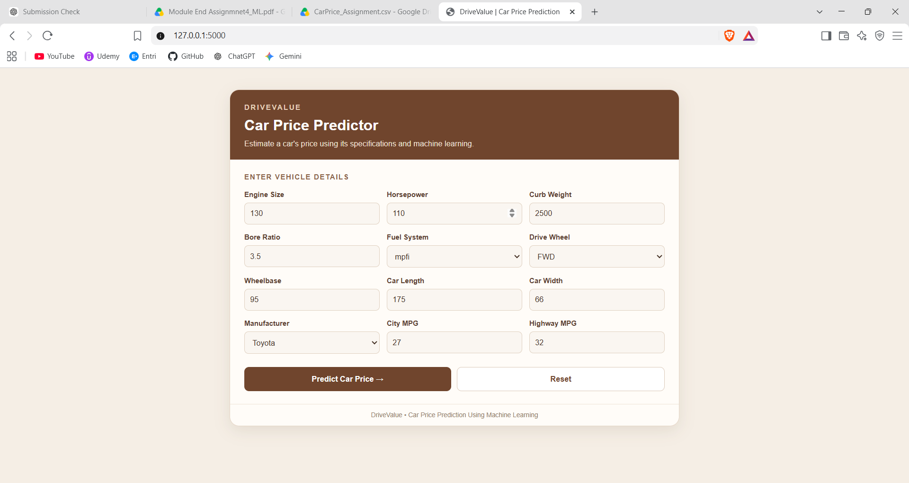
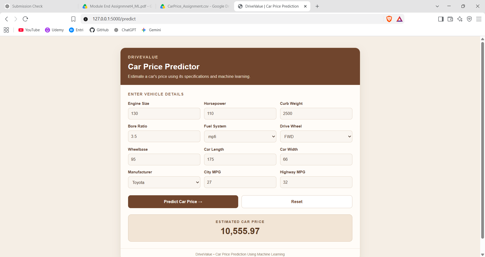

# DriveValue – Car Price Prediction Using Machine Learning

### End-to-End Machine Learning & Flask Web Application

---

## 1. Project Overview

DriveValue is a machine learning project that estimates a car's price from selected vehicle specifications. It covers data exploration, preprocessing, feature engineering, model training, evaluation, hyperparameter tuning, model saving, and a Flask web application for predictions.

The predicted price is an estimate based on the dataset and is not a guaranteed market price.

---

## 2. Project Objectives

- Explore and understand the car price dataset.
- Clean the data and prepare useful features.
- Use 12 selected input features to predict car prices.
- Train and compare regression models.
- Evaluate models using MAE, MSE, RMSE, and R².
- Tune a Random Forest Regressor using GridSearchCV.
- Save the complete trained pipeline.
- Build a Flask application with its HTML and CSS embedded in `app.py`.

---

## 3. Dataset Overview

The project uses `CarPrice_Assignment.csv`.

- **Number of records:** 205
- **Number of columns:** 26
- **Target column:** `price`
- **Problem type:** Regression

### Selected 12 input features

| No. | Input feature | Dataset column |
|---:|---|---|
| 1 | Engine Size | `enginesize` |
| 2 | Horsepower | `horsepower` |
| 3 | Curb Weight | `curbweight` |
| 4 | Bore Ratio | `boreratio` |
| 5 | Fuel System | `fuelsystem` |
| 6 | Drive Wheel Layout | `drivewheel` |
| 7 | Wheelbase | `wheelbase` |
| 8 | Car Length | `carlength` |
| 9 | Car Width | `carwidth` |
| 10 | Manufacturer | `manufacturer` |
| 11 | City Fuel Economy | `citympg` |
| 12 | Highway Fuel Economy | `highwaympg` |

The `manufacturer` feature is extracted from `CarName` during feature engineering. The target `price` is kept separate from the input features.

---

## 4. Data Preprocessing and Feature Engineering

The notebook includes:

- Checking missing values and duplicate records.
- Inspecting numerical outliers using the Interquartile Range (IQR) method.
- Examining skewness of numerical columns.
- Exploring price distributions and relationships between car features and price.
- Extracting the manufacturer from `CarName`.
- Selecting the 12 input features and the `price` target.
- Splitting the data into training and testing sets.

Numerical features are scaled using `StandardScaler`; categorical features are encoded using `OneHotEncoder`. These transformations are included in the scikit-learn pipeline.

---

## 5. Exploratory Data Analysis (EDA)

The notebook includes visualizations such as:

1. Histogram of car prices.
2. Box plot of car prices.
3. Count plot of fuel types.
4. Average price by car body style.
5. Engine size versus price scatter plot.
6. Horsepower versus price scatter plot.
7. Correlation heatmap of numerical features.

These plots help inspect price distribution, potential outliers, and relationships between vehicle specifications and price.

---

## 6. Model Training and Evaluation

The following five regression algorithms are compared:

1. Linear Regression
2. Decision Tree Regressor
3. Random Forest Regressor
4. Gradient Boosting Regressor
5. Support Vector Regression (SVR)

### Evaluation metrics

- **MAE (Mean Absolute Error):** Average absolute difference between actual and predicted prices.
- **MSE (Mean Squared Error):** Average squared prediction error.
- **RMSE (Root Mean Squared Error):** Square root of MSE, expressed in the target's units.
- **R² Score:** Indicates how much variation in the target prices is explained by the model.

The notebook displays the measured results. The model with the lowest RMSE is considered the best baseline model according to that metric.

---

## 7. Hyperparameter Tuning and Model Saving

`GridSearchCV` with 5-fold cross-validation is used to tune the Random Forest Regressor. The search explores:

- `n_estimators`
- `max_depth`
- `min_samples_split`

The preprocessing transformer and model are combined into one pipeline so the same transformations are applied during training and prediction.

The tuned pipeline is saved as:

```text
DriveValue_CarPrice_Model.pkl
```

The saved file contains the preprocessing steps and fitted model. It must be used with the same 12 feature names and compatible library versions as the training environment.

---

## 8. Web Application

The web application is built with Flask. The HTML and CSS are embedded directly in `app.py`, so a separate `index.html` file is not required for this version.

### Main features

- 12 input fields for car specifications.
- Dropdowns for fuel system, drive-wheel layout, and manufacturer.
- Predict Car Price button.
- Estimated price display.
- Reset / Clear All button.
- Form values retained after prediction.
- Error message displayed if prediction fails.

### Application file structure

```text
Entri_Codeathon/
├── app.py
└── DriveValue_CarPrice_Model.pkl
```

The dataset and Jupyter notebook may be stored in the project folder or a separate notebook folder.

---

## 9. Installation and Execution

### Step 1: Install the required packages

Open the VS Code terminal in the project folder and run:

```bash
pip install flask pandas scikit-learn joblib
```

### Step 2: Check the project files

Make sure these files are in the same folder:

- `app.py`
- `DriveValue_CarPrice_Model.pkl`

### Step 3: Start the Flask application

```bash
python app.py
```

### Step 4: Open the website

Open this address in a browser:

```text
http://127.0.0.1:5000
```

Fill in the 12 fields and click **Predict Car Price** to see the estimate.

---

## 10. Important Notes and Troubleshooting

- The saved model must have been trained using the same 12 input features listed in this README. A model trained with a different feature set will not work correctly with this form.
- The categorical values submitted by the form must match the categories used when training the model.
- A scikit-learn version warning may appear if the model was saved with a different version from the one currently installed. For reliable results, use a compatible version matching the training environment and retrain/resave the model if necessary.
- The estimated price depends on the quality and coverage of the dataset.
- Do not use `debug=True` for a public production deployment.

---

## 11. Conclusion

DriveValue demonstrates an end-to-end regression workflow for car price estimation, from dataset exploration and feature preparation to model comparison, hyperparameter tuning, and a Flask-based prediction interface.

The project provides an accessible way to estimate car prices from selected vehicle specifications. Future improvements could include a larger and more recent dataset, improved manufacturer-category handling, stronger validation, and deployment to a hosted service.

---

## 12. Output Screenshots

Add your own screenshots after running the application.

### Screenshot 1: Initial Web Application

Save a screenshot of the page before entering any values as `ss1.png`.



### Screenshot 2: Prediction Result

Save a screenshot showing completed inputs and the predicted price as `ss2.png`.


